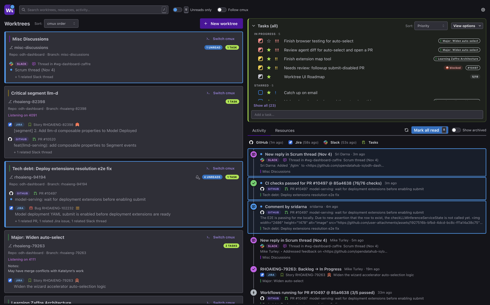

#  worktree

**worktree** puts your work and its context in the same place. It gives each thing you're working on an isolated, complete home: a git worktree with its own port range and kubeconfig, plus the GitHub PRs, Jira issues and Slack threads it's about.

The **CLI** lets you and your AI agents create worktrees and manage everything attached to them. The **web UI** gives you:

- a live inbox of the outside activity on each worktree
- a code view where you can send review comments to an agent or to a PR
- a task list that sits right next to the work it's about


<!-- SCREENSHOT TODO: hero.png — dark mode, wide. Home page with 3–4 worktrees carrying mixed PR/Jira/Slack resources, some unread, and the Activity feed beside them. Demo or sanitized data only. -->

**[Quick start](#quick-start)** · **[CLI reference](docs/cli.md)** · **[Setup guide](docs/setup.md)** · **[Configuration](docs/configuration.md)**

## Highlights

- **Live GitHub, Jira and Slack activity, grouped by the work it's about.** Every worktree collects the activity on its own resources, so you never have to work out which PR comment or Slack reply belongs to what.
- **An isolated environment per worktree.** Each one has its own port range and kubeconfig, so you can run several dev servers and stay logged in to different clusters at the same time.
- **Slack threads, read and answered inline**, next to the PRs and issues they're about.
- **Notifications and unread tracking** for each resource, so you know exactly what's new since you last looked.
- **Tasks that live with their context**, with blockers that clear themselves when a PR merges or an issue is done.
- **One review view for your changes and for PRs**: send comments to an AI agent or to GitHub, and open your editor on the file you're looking at.
- **One-command worktrees** from a branch name, a PR number or URL, or a Jira issue.
- **A macOS menu bar app** that keeps your tasks and activity one click away, and blinks when something's unread.
- **Deep [cmux](https://cmux.com/) integration**, and a UI that works from your phone.

## Quick start

You need `git`, [Go](https://go.dev/dl/) (1.26+) and Node.js with `npm` (to build the web UI).

**1. Install**

```bash
git clone https://github.com/mturley/worktree.git
cd worktree
make install    # builds the UI and the binary, installs to /usr/local/bin, then runs setup
```

**2. Set up.** `make install` runs `worktree setup` for you. It's a re-runnable wizard that sets up your directories and shell hook, generates the web UI password, connects GitHub, Jira and Slack, and on macOS offers to install the [menu bar app](#in-your-menu-bar-macos). Each service is optional. Run `worktree setup` again any time to fix or add something. See the [setup guide](docs/setup.md) for details.

**3. Start the web UI**

```bash
worktree ui     # http://127.0.0.1:8475, opens in your browser
```

Log in with the password setup printed. If you lost it, the login page tells you where to find it.

**4. Create a worktree.** From the UI's **New worktree** button, or from inside a git repo:

```bash
worktree add my-feature                                  # a new branch
worktree add 1234                                        # PR #1234 in this repo
worktree add https://github.com/org/repo/pull/1234       # any PR, by URL
worktree add https://your-org.atlassian.net/browse/PROJ-56   # a Jira issue
```

The command is also installed as `wt`.¹ To update, `git pull` and run `make install` again. The web UI shows a banner when there's a newer version on `main`.

Next: the [CLI reference](docs/cli.md) lists every command, and the [configuration reference](docs/configuration.md) covers every setting.

## Every worktree is its own environment

Working on several things at once usually means your work trips over itself: two dev servers both want port 3000, and an `oc login` for one task quietly switches the cluster under another. worktree gives every worktree its own environment, so you don't have to work that way.

- **A reserved port range.** Each worktree gets 10 ports of its own, such as `4020-4029`, in `$WORKTREE_PORTS`. Point your dev servers at them and you can run the app from three branches side by side.
- **Its own kubeconfig.** Each worktree gets its own `$KUBECONFIG`, which starts as a copy of your current one. Logging in from one worktree logs in *that* worktree only, so one PR can be on a dev cluster while another is on staging.
- **Set automatically.** The shell hook installed by `worktree setup` exports both whenever you `cd` into a worktree. The web UI shows them on each worktree's Environment tab.

```console
$ cd ~/.worktrees/my-app/feature-a && echo $WORKTREE_PORTS $KUBECONFIG
4020-4029 /Users/you/.kube/config-my-app-feature-a

$ cd ~/.worktrees/my-app/pr-1234 && echo $WORKTREE_PORTS $KUBECONFIG
4030-4039 /Users/you/.kube/config-my-app-pr-1234
```

To start a dev server on the first port in the range:

```bash
PORT=${WORKTREE_PORTS%-*} npm run dev
```

<!-- SCREENSHOT TODO (optional): environment.png — dark mode. Two terminals side by side in different worktrees, or a worktree's Environment tab. -->

## The web UI

`worktree ui` serves the web UI from the same single binary. There's nothing else to install. It shows the same data the CLI works with, and stays live: a background loop polls every followed PR, Jira issue and Slack thread and pushes updates to the browser as they happen.

### Everything at a glance


<!-- SCREENSHOT TODO: home.png — dark mode. Home page: worktree cards on the left, Activity feed on the right; the Resources tab could be shown instead if the hero already covers this. -->

The home page lists every worktree as a card. Each card shows its repo and branch, its cmux workspace if it has one, and the resources it's about, each with a status icon, a reference like `#1234` or `PROJ-56`, and who owns it.

Beside the cards, the **Activity** feed merges events from every followed PR, Jira issue and Slack thread, newest first. Each event is tagged with the worktrees it belongs to, and you can filter by source, event type or unread. The **Resources** tab lists everything you follow across all worktrees. Hover a resource and the worktrees that follow it light up, and the other way around.

### One worktree, one page


<!-- SCREENSHOT TODO: worktree-detail.png — dark mode. Worktree page with a PR selected: its activity and its Linked Resources tab. -->

Open a worktree to see only its world: its resources, their activity, its notes, its tasks and its environment.

- **Focus on one resource.** Select a PR or Jira issue to narrow the activity to it. You can rename resources, reorder them, and mark each one *Focus* (what this worktree is for) or *Related* (followed for context).
- **Slack threads render inline.** Read a thread, reply (with @-mention, channel and emoji autocomplete), react, and mark it read when you choose. Looking at a thread never marks it read.
- **Linked Resources.** Shows what a PR, issue or thread links to, including the Jira issue hierarchy, so you can follow it with one click.
- **Any web page can be a resource.** Follow a design doc or dashboard alongside your PRs, and it opens in place.
- **Notes.** Free text that saves as you type and can be mirrored to the cmux workspace's description.


<!-- SCREENSHOT TODO: slack-thread.png — dark mode. A Slack thread selected on a worktree page, composer visible. Synthetic content only. -->

### Never miss an update

- **Unread is tracked per resource**, so a reply to a PR shows up as unread on every worktree that follows it, and clears everywhere once you've read it. Use the unread-only filter, or mark everything read at once.
- **Desktop notifications** are opt-in, for a whole worktree or for individual resources. They're delivered through cmux when it's available, or by the browser otherwise. You can also set a command of your own to run for each notification.
- **Your own activity is never news.** Your comments, edits and messages don't count as unread or notify you.
- **The browser tab shows unread too.** The title carries a count and the icon shows a dot, so a background tab still tells you something arrived. In cmux, a 📬 appears in front of the title of any workspace with unread activity.

<!-- SCREENSHOT TODO: notifications.png — dark mode. A worktree card or resource with unread badges and the notify toggles open. -->

### Tasks: what to do next, next to what it's about


<!-- SCREENSHOT TODO: tasks.png — dark mode. A task list with a starred group, a blocked task and priority marks. -->

Tasks are to-dos that live with the context they're about. Link a task to a worktree, a PR, a Jira issue or a Slack thread. Then, whenever you're looking at that worktree or resource, its tasks are right beside its activity. The home page lists every task in one hand-ordered list, and each task's links take you straight to the worktree or resource it's about.

- **Quick add** from any task list, or turn an event or a Slack message into a task with **＋ task**.
- **Drag to reorder.** Dragging also stars a task or changes its priority, depending on where you drop it.
- **The detail view** holds a description, subtasks, links, the events the task came from, and its full history.
- **Blockers** can be another task, a PR, a Jira issue or anything you type. A task blocker clears when that task is done, and a PR or Jira blocker clears when the PR merges or closes or the issue reaches Done. You get an *Unblocked* notification when that happens.
- **Undo** is offered for every state change, checked subtask, delete and mark-read.
- **Built for agents too.** `worktree tasks … --json` lets AI agents read and update the same list. Their changes are recorded as an agent's and can notify you, and an agent can't undo something you did.


<!-- SCREENSHOT TODO: task-modal.png — dark mode. Task detail with subtasks, links and a PR blocker. -->

### Find anything

Search filters the page you're on as you type. On the home page it narrows worktrees, activity, resources and tasks together. On a worktree page it stays within that worktree. Suggestions show what each match is and why it matched, and the query lives in the URL, so Back and reload keep it.

<!-- SCREENSHOT TODO: search.png — dark mode. Home page narrowed by a search, suggestions open. -->

### Review code, yours or theirs


<!-- SCREENSHOT TODO: diff-view.png — dark mode. Diff view showing a local review comment and a PR review thread inline. -->

Each worktree's **Code** tab shows its git state (merge base, ahead/behind, tracking branch, uncommitted changes) and the files changed. **Review changes** opens a full diff view with a file tree. You can compare against the merge base or the tracking branch, and pick any range of commits, with or without uncommitted changes. The same view serves two purposes:

- **Review your own changes, or an agent's.** Leave comments on any line of your local diff. They stay attached to the code they're about as it changes, and are flagged when it's gone. **Copy comments for agent** turns them all into one prompt to hand to a coding agent.
- **Review a PR.** The PR's review threads appear inline in the same diff, with unread markers on new replies. Reply, comment on a line, and start and submit a review on GitHub without leaving the page.

**Open in editor** opens the worktree, or the file you're looking at in the diff, in your editor.

<!-- SCREENSHOT TODO: code-tab.png — dark mode. The Code tab: git summary and files changed. -->

### Works with cmux

When `worktree ui` runs inside [cmux](https://cmux.com/), the two work together:

- **Workspaces on every card.** Each worktree card is headed by its cmux workspace's name and color, with a button to jump to its terminals, or to create a workspace if it has none.
- **Follow cmux.** Turn this on and the browser tab follows along, showing whichever worktree you switch to in cmux.
- **The cmux tab** on a worktree's page draws its workspace's pane layout. You can focus, close, move and rename tabs from there, and hover a tab to peek at its screen.


<!-- SCREENSHOT TODO: cmux.png — dark mode. A worktree's cmux tab: pane diagram with a tab peek open. -->

### In your menu bar (macOS)


<!-- SCREENSHOT TODO: menubar.png — dark mode. The menu bar icon with its dropdown open on the Activity tab (or Tasks). -->

On a Mac, setup can install a small menu bar app. It keeps your activity feed and task list one click away, without a browser tab.

- **Unread at a glance.** The icon blinks blue while anything is unread.
- **Activity and Tasks in a dropdown.** Click the icon for both, with search. Task and event details open right in the dropdown, and anything else opens the full UI in your browser.
- **Fits your screen.** Drag the dropdown's corner to resize it, and it remembers the size.
- **Optionally starts at login.** Right-click the icon for that and its other options.

The app is built on your machine from source embedded in worktree, so it needs `swiftc` (Xcode Command Line Tools), and `worktree ui` must be running. Run `worktree setup` interactively to install it, and setup rebuilds it whenever an update changes it. See the [setup guide](docs/setup.md#macos-menu-bar-app) for details.

### From your phone

`worktree setup` can turn on HTTPS access from your other devices. It finds this machine's `.local` name and LAN address and issues a certificate from a CA that can't sign anything else. Install that CA on your phone and you can reach the UI at `https://<your-mac>.local:8476`. The layout adapts to narrow screens. Every browser has to log in with the UI password, and **Settings → Devices** lets you log out any of them.

<!-- SCREENSHOT TODO: mobile.png — dark mode. The home page at phone width. -->

### Settings

Every setting can be edited in the UI's **Settings** window, including the GitHub, Jira and Slack credentials, notifications, remote access and devices. Each service can be switched off, and a service that's off is never contacted. A **Logs** tab shows what the background polling has been doing.

## Creating worktrees

`worktree add` (or **New worktree** in the UI) works out what you passed:

| Argument | Creates |
|---|---|
| `my-feature` | A worktree on a new branch from the current HEAD (offering to `git pull` first) |
| `1234` | A worktree for PR #1234 in the current repo |
| `https://github.com/org/repo/pull/1234` | A worktree for that PR, from your local clone of that repo |
| `https://your-org.atlassian.net/browse/PROJ-56` | A worktree whose branch is named after the issue key |

For a PR, worktree finds your local clone of the PR's repo and checks out the PR's branch. It picks the right remote by URL, not by name, so fork setups with `origin` and `upstream` work. Every new worktree:

1. lives under `~/.worktrees/<repo>/<name>`
2. gets its own port range and kubeconfig (see [above](#every-worktree-is-its-own-environment))
3. follows its PR and any Jira issues detected from the PR title, body and branch name
4. can copy your gitignored dotfiles (`.env.local` and the like) from the main checkout
5. opens in a new cmux workspace, if you ran the command from a cmux pane. That workspace has the PR, its Jira issues and the worktree's UI page as browser tabs, plus terminals for working and for `worktree info`. Outside cmux, worktree prints the `cd` command for the new worktree instead.

`worktree delete` removes the worktree and its port range, kubeconfig and records. In the UI, you confirm by typing the worktree's name and watch each cleanup step as it runs.

## The CLI

The CLI covers everything the UI does with worktrees, resources and tasks, and every data command has `--json` output for scripts and AI agents.

| Command | What it does |
|---|---|
| `worktree add <branch \| PR \| URL>` | Create a worktree |
| `worktree list` | List worktrees (marking any open in cmux) |
| `worktree info [path]` | Show a worktree's environment and resources |
| `worktree open [--github \| --jira]` | Open the worktree in your editor, or its PR or Jira issue in the browser |
| `worktree delete [path]` | Remove a worktree and clean up after it |
| `worktree resources add <url>` | Follow a PR, Jira issue, Slack thread or web page from the current worktree |
| `worktree tasks add <title>` | Add a task, linked to the current worktree |
| `worktree tasks list` | List the current worktree's open tasks |
| `worktree ui` | Start the web UI |
| `worktree setup` | Configure (or re-check) everything |

**→ [Full CLI reference](docs/cli.md)**, including every `tasks` and `resources` subcommand, the JSON output formats and agent usage.

## Integrations

| Service | What it enables |
|---|---|
| **GitHub** | PR status and activity, review threads in the diff view, writing to PRs, creating a worktree from a PR |
| **Jira** | Issue status and activity, detecting issue keys, the issue hierarchy in Linked Resources |
| **Slack** | Threads as resources, read and answered inline, with unread mirrored from Slack |
| **[cmux](https://cmux.com/)** | Workspaces for worktrees, follow cmux, the cmux tab, notifications, 📬 on workspace titles |

All of them are optional, and `worktree setup` connects each one. The GitHub token can be taken from the GitHub CLI if you're logged in to it. The Slack session is captured by logging in through a browser that setup opens. Credentials live in `~/.config/watcher/auth.yaml` (mode `0600`).

> **Slack security note:** worktree uses your own Slack session (token and cookie), not an app token. Treat it like a password.

worktree also works with [agent-handler](https://github.com/mturley/agent-handler), which follows a worktree's resources when an AI agent session starts in it. Neither tool needs the other.

## Configuration

`worktree setup` writes `~/.config/worktree/config.yaml`, and the UI's Settings window edits it. You rarely need to touch the file directly. **→ [Configuration reference](docs/configuration.md)**

## Development

```bash
make build    # build the UI (ui/) and the Go binary (bin/worktree), with the UI embedded
make dev      # Go API + Vite dev server with hot reload (uses mprocs if installed)
make test     # go test ./...
make macapp   # build the macOS menu bar app into bin/
```

The frontend is React with [Mantine](https://mantine.dev/), built with Vite. The backend is Go with SQLite. The menu bar app is a small Swift app, built with plain `swiftc`, that hosts the UI's `/mini` page. GitHub, Jira and Slack polling comes from the [watcher](https://github.com/mturley/watcher) library. [`docs/web-ui-architecture.md`](docs/web-ui-architecture.md) maps the web UI's backend, API and frontend.

## License

CC0 1.0 Universal — public domain dedication.

---

¹ `wt` is a symlink to `worktree`, so every command in this README works as `wt <command>` too.
